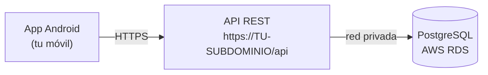

# Guía de la App Android: del código al APK en tu móvil

**Módulo:** Proyecto Intermodular (2º DAM y 2º DAW)  
**Ciclo Formativo:** Desarrollo de Aplicaciones Multiplataforma y Web  
**Proyecto:** Pizzería Bella Napoli  
**Tiempo estimado:** unos 15 minutos, la mayor parte esperando a que GitHub compile el APK [POR VERIFICAR EN LAB LIMPIO]  

> **Antes de empezar:** necesitas el servidor de la [Guía de Despliegue Directo](GUIA_DESPLIEGUE_DIRECTO.md)
> funcionando. Si el laboratorio estaba parado, arráncalo con la [Ficha de continuidad](FICHA_CONTINUIDAD.md).

> **Cómo leer esta guía:** cada paso tiene lo que haces **en el laboratorio** y un recuadro
> **«En un proyecto real»** con lo que haría un equipo de desarrollo y por qué aquí se simplifica.
> Si mencionamos una clave de laboratorio, está en la tabla de la guía de despliegue directo.

---

## 1. Qué vamos a conseguir

Vas a obtener un **APK** (el instalador de una app Android) que ya sabe cuál es **tu** servidor, lo vas a
instalar en tu móvil y vas a hacer un pedido. No hace falta Android Studio ni instalar nada en tu ordenador:
**GitHub compila el APK por ti**.

La app **solo habla con la API**; la API es la única que habla con la base de datos.

> **En un proyecto real:** la base de datos nunca se expone a una app móvil. Una app se instala en
> miles de teléfonos y cualquiera puede abrirla por dentro: si llevara usuario y clave de la base de datos,
> todos tendrían acceso total. La API decide qué puede hacer cada petición. Aquí ya lo cumples: RDS no es
> accesible desde Internet.

---

## 2. Requisitos

* El servidor de la [guía de despliegue directo](GUIA_DESPLIEGUE_DIRECTO.md) funcionando y accesible en `https://<TU_SUBDOMINIO>`
  (el subdominio que te dio el profesor). Ábrelo en el navegador del móvil: debe cargar la carta.
* Un repositorio tuyo en GitHub creado desde la plantilla del profesor:
  1. Abre <https://github.com/guillermofoix/pizzeria-base> y pulsa **Use this template**.
  2. Elige **Create a new repository**.
  3. En **Owner** elige tu cuenta y ponle el nombre que quieras.
  4. Marca la visibilidad **Public** y pulsa **Create repository**.

  Tiene que ser **público** porque la Release con el APK se descarga desde el móvil sin iniciar sesión en GitHub,
  y no contiene secretos: el `.env` no se sube al repositorio y la URL del servidor es una variable.

  El repositorio nuevo **no hereda la historia ni las variables** del original. Por eso tienes que crear tú la
  variable `URL_SERVIDOR` (paso 3).
* Un móvil Android.
* Opcional: los pagos con tarjeta de prueba, que se activan en el Apéndice A de la [guía de despliegue directo](GUIA_DESPLIEGUE_DIRECTO.md).

> **¿Tienes iPhone?** Un APK solo se instala en Android. Haz la guía hasta el paso 4 (compilar y descargar el APK)
> y prueba la instalación en el móvil Android de un compañero.

> **Coste en el laboratorio:** la compilación corre en GitHub, no en AWS, y no gasta crédito del laboratorio.
> Lo que sí consume es el servidor mientras esté encendido: apágalo al terminar según la [Ficha de continuidad](FICHA_CONTINUIDAD.md).

> **En un proyecto real:** las pruebas de una app se hacen contra un servidor de **pruebas**, no contra el de
> producción donde compran los clientes. Aquí solo tienes un servidor, que hace de los dos.

> [!NOTE]
> [POR VERIFICAR EN LAB LIMPIO] En un repositorio creado desde una plantilla, GitHub Actions puede venir
> desactivado. Si en la pestaña **Actions** aparece un aviso para habilitar los workflows, púlsalo.

---

## 3. Crear la variable `URL_SERVIDOR` (antes de compilar)

La dirección de tu servidor **se fija al compilar**: el APK la lleva dentro y la app arranca sin preguntarla.
La lee el workflow de la variable de repositorio `URL_SERVIDOR`.

1. En **tu** repositorio de GitHub: **Settings** $\rightarrow$ **Secrets and variables** $\rightarrow$ **Actions**.
2. Abre la pestaña **Variables** (no *Secrets*: la dirección no es secreta).
3. Pulsa **New repository variable**.
4. **Name:** `URL_SERVIDOR` (en mayúsculas, exactamente así).
5. **Value:** `https://<TU_SUBDOMINIO>`, por ejemplo `https://dam-01.tudominio.org`.
   * Empieza por **`https://`**, **sin barra final**, sin espacios ni comillas.
6. Pulsa **Add variable**.

Si el valor no es válido, la compilación **falla** con el mensaje *«URL_SERVIDOR no es válida»* (paso *Comprobar la variable URL_SERVIDOR*). Es lo esperado: corrige la variable y vuelve a lanzar.

> **En un proyecto real:** la URL del servidor no se escribe en el código: llega por configuración y hay una por
> entorno (pruebas y producción), de modo que el mismo código genera la app de cada uno. Los **secretos** (claves,
> certificados de firma) van en los *secrets* del CI, nunca en el repositorio ni dentro del APK, porque un APK
> se puede descomprimir. Por eso aquí es una *variable* y no un *secret*: una dirección pública no es un secreto.

---

## 4. Lanzar la compilación y descargar el APK

El workflow **App Android** (`.github/workflows/app.yml`) compila y prueba la app. Se dispara de tres formas:

* **A mano** (la que usarás): pestaña **Actions** $\rightarrow$ **App Android** $\rightarrow$ **Run workflow** (rama `main`).
* Con un **push** a cualquier rama que cambie algo dentro de `app/` o el propio workflow.
* Con una **etiqueta** `v*` (por ejemplo `v1.0`): además genera un APK de *release* firmado, pero necesita secretos
  de firma que en el laboratorio no tienes. **No lo uses aquí.**

**Descargar el APK (camino del laboratorio):**

1. Lanza **Run workflow** y espera a que termine con la marca verde (unos minutos).
2. En la página principal de tu repositorio, entra en **Releases** y abre la versión **`dev-latest`**
   (marcada como *pre-release*).
3. Descarga **`pizzeria-dev.apk`**. Puedes hacerlo **directamente desde el navegador del móvil**, sin pasar por el ordenador.
   Si el repositorio es privado, el móvil tendrá que iniciar sesión en GitHub.

Cada nueva ejecución **sustituye** a la Release `dev-latest` anterior: siempre es el APK más reciente.

> [!NOTE]
> [POR VERIFICAR EN LAB LIMPIO] Que la Release `dev-latest` aparece tras una ejecución manual con *Run workflow*.
> Si no aparece, mira el trabajo **Publicar dev-latest** en la ejecución; si dice que se omitió, la rama
> desde la que lanzaste no tiene el workflow actualizado.
>
> Alternativa: en la misma ejecución, bajo **Artifacts**, está **`apk-debug`**, un `.zip` con el mismo APK que se
> conserva 14 días.

> **En un proyecto real:** la compilación la hace **integración continua** en cada cambio, para que nadie dependa
> del ordenador de otra persona. Hay dos tipos de APK: el de **pruebas** (como este, de depuración, para el equipo)
> y el de **release**, **firmado** con una clave que solo conoce el equipo y **versionado** (`v1.0`, `v1.1`…). Ese APK
> se distribuye por una tienda (Google Play) o por un canal interno. En el laboratorio nos quedamos en el de pruebas.

---

## 5. Instalar el APK en el móvil

1. Abre `pizzeria-dev.apk` desde el móvil (Descargas o la barra de notificaciones del navegador).
2. Android pedirá permiso para **instalar aplicaciones de orígenes desconocidos** para esa aplicación (el navegador o el gestor de archivos desde el que lo abres). Actívalo solo para esa app.
3. Puede aparecer un aviso de **Google Play Protect** indicando que la app no es conocida o que no está verificada.
   Es normal con un APK que no viene de la tienda: elige la opción de instalar de todos modos.
   [POR VERIFICAR EN LAB LIMPIO] el texto exacto del aviso, que cambia según la marca del móvil y la versión de Android.
4. Pulsa **Instalar** y abre la app.

> **En un proyecto real:** estos avisos existen porque el APK no pasa por una tienda. Una app distribuida en Google
> Play, o por un canal interno de la empresa, se instala sin tocar los orígenes desconocidos, y el usuario no
> tiene que rebajar la seguridad de su móvil para usarla.

---

## 6. Comprobar que funciona

1. **Diagnóstico.** En el inicio de la app, abre **Ajustes del servidor** (o **Cambiar servidor**) $\rightarrow$ **Diagnóstico**. Comprueba que el **servidor activo** es el tuyo y que su origen es *fijado al compilar*. Ahí también ves la versión y el commit con el que se compiló.
2. **La carta.** Vuelve al inicio: deben cargar las pizzas desde tu servidor. Si no cargan, ve al paso 7.
3. **Pedido en efectivo.** Añade pizzas al carrito, elige **Efectivo al recoger** (o *al recibir*) y envía el pedido. Verás su número.
4. **Seguimiento.** La app consulta el estado del pedido en el servidor. Puedes cambiarlo desde el panel de cocina (KDS) de la web `https://<TU_SUBDOMINIO>/` y volver a la app a ver el cambio. [POR VERIFICAR EN LAB LIMPIO] cuánto tarda la app en reflejarlo.
5. **Pedido con tarjeta de prueba** (solo si activaste Stripe). Elige **Pagar con tarjeta**: la app abre la página de pago de Stripe en el navegador del móvil. Paga con `4242 4242 4242 4242`, cualquier fecha futura y CVC `123`. Al terminar **se vuelve a la web**, no a la app: abre la app de nuevo y pulsa **Ya he pagado, comprobar** para que consulte el estado del pago.

> **Coste en el laboratorio:** la prueba solo necesita el servidor encendido. En cuanto termines, páralo
> siguiendo la [Ficha de continuidad](FICHA_CONTINUIDAD.md).

> **En un proyecto real:** el flujo de pago se prueba siempre en **modo de prueba** (tarjetas de mentira) y solo
> cuando todo funciona se activa el modo real. Además, el pedido no se marca como pagado porque la app lo diga,
> sino porque lo confirma el servidor con el aviso de la pasarela. Y, como la base de datos tiene pedidos
> reales, se hacen **copias de seguridad** y se comprueba que se pueden restaurar.

---

## 7. Errores frecuentes

| Síntoma | Causa probable | Solución |
| :--- | :--- | :--- |
| El workflow falla con *«URL_SERVIDOR no es válida»* | La variable no empieza por `https://`, lleva espacios o comillas | Corrige la variable (pasos 3.4 a 3.6) y vuelve a lanzar el workflow |
| La app abre pero pide la dirección del servidor | Compilaste **antes** de crear la variable (APK genérico) | Crea la variable y **relanza el workflow**; descarga e instala el APK nuevo |
| La app apunta a un servidor que no es el tuyo | Instalaste un APK **antiguo** o la dirección guardada en el teléfono manda sobre la compilada | Desinstala el APK viejo, instala el nuevo y revisa **Diagnóstico**; ver el paso 8 |
| La URL de la variable termina en `/` | La dirección no debe terminar en `/` | Quita la `/` final de `URL_SERVIDOR` y vuelve a compilar |
| Con `http://` no compila | Android bloquea el tráfico sin cifrar (`usesCleartextTraffic=false`) y el workflow lo rechaza | Usa siempre `https://` (tu túnel de Cloudflare ya lo da) |
| La app dice que no puede conectar y ofrece **Reintentar** | El servidor está apagado o el túnel no responde | Ábrelo en el navegador del móvil; arranca el laboratorio con la [Ficha de continuidad](FICHA_CONTINUIDAD.md) |
| **Pagar con tarjeta** dice que no está disponible | Los pagos no están activados en el servidor | Apéndice A de la [guía de despliegue directo](GUIA_DESPLIEGUE_DIRECTO.md) |
| Pagas con tarjeta pero el pedido sigue sin pagar | No has vuelto a la app o aún no se ha confirmado | Abre la app y pulsa **Ya he pagado, comprobar** |
| No aparece la Release `dev-latest` | El workflow no ha terminado o falló antes de publicar | Revisa la ejecución en **Actions**; si fue bien, relánzala con **Run workflow** |

---

## 8. Cambiar de servidor

La app elige el servidor en este orden:

1. La dirección **guardada en el teléfono** (si alguien la cambió en *Ajustes del servidor*).
2. La **fijada al compilar** (`URL_SERVIDOR`).
3. Ninguna: pide la dirección en la pantalla de configuración.

Para apuntar a otro servidor, haz los pasos **en este orden**:

1. Cambia el valor de la variable `URL_SERVIDOR` (paso 3).
2. **Relanza el workflow** (paso 4) e instala el APK nuevo. Un APK ya compilado no cambia de servidor.
3. Si el teléfono tiene guardada una dirección anterior, esa manda: cámbiala en **Ajustes del servidor** o borra los datos de la app.
4. Confirma el resultado en **Diagnóstico**.

> **En un proyecto real:** se compila una app por entorno (pruebas y producción), con su URL, y el usuario final
> nunca escribe la dirección del servidor. La pantalla de «cambiar servidor» es una herramienta de desarrollo.

---

## 9. Si usas Android Studio (no es el camino de esta guía)

[POR VERIFICAR EN LAB LIMPIO] Esta guía **no** necesita Android Studio y no se ha probado con él.

* `app/` es un proyecto **Gradle estándar** (Kotlin Multiplatform; el módulo de la app es `androidApp`). El CI lo compila con Java 21 (Azul Zulu).
* En `androidApp/build.gradle.kts`, el script lee la variable de **entorno** `URL_SERVIDOR`, comprueba que empieza por `https://` y no tiene espacios ni comillas (si no, lanza un error) y la guarda en el campo `URL_SERVIDOR` de `BuildConfig`. La app lo recibe al arrancar en `PizzeriaApplication`.
* En local, como en el CI, la variable debe existir en el entorno al compilar, por ejemplo: `URL_SERVIDOR=https://<TU_SUBDOMINIO> ./gradlew :androidApp:assembleDebug`. Un Android Studio abierto desde el escritorio puede no ver las variables de tu terminal.
* Sin variable, el APK sale genérico y pide el servidor en la app.
