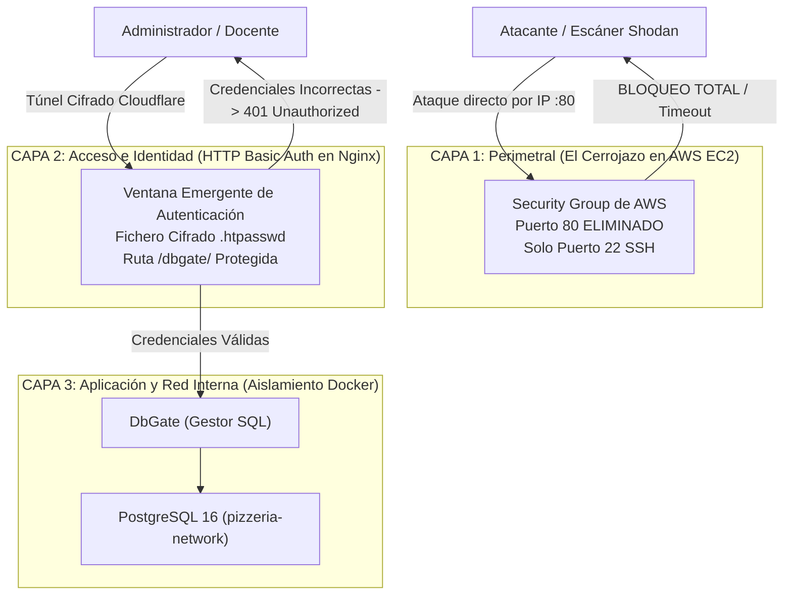

# Práctica 5: Defensa en Profundidad, Hardening Perimetral y Zero Trust

**Módulo:** Despliegue de Aplicaciones Web (2º DAW)  
**Ciclo Formativo:** Desarrollo de Aplicaciones Web / Multiplataforma  
**Proyecto:** Pizzería Bella Napoli  
**Requisitos previos:**  
- [Práctica 1: Despliegue en AWS EC2](P01_Despliegue_AWS.md)
- [Práctica 2: Conectividad y Túneles Zero Trust](P02_Conectividad_Cloudflare_Tunnels.md)
- [Práctica 3: Securización Perimetral y Auditoría Web](P03_Securizacion_HTTPS_Hardening.md)
- [Práctica 4: Desacople de Arquitectura en Docker](P04_Desacople_BD.md)
- [Flujo de Trabajo (WORKFLOW.md)](WORKFLOW.md)

---

## 1. Contexto: El Principio de Defensa en Profundidad

En la Práctica 2 y 3 logramos que nuestra aplicación fuera accesible a través de Internet con HTTPS mediante Cloudflare Tunnels. Sin embargo, si analizamos la arquitectura con ojos de auditor de seguridad, descubrimos **dos vulnerabilidades críticas**:

1. **Superficie de ataque residual en AWS:** En el Grupo de Seguridad de AWS dejamos abierto el puerto **80 (HTTP)** a todo el mundo (`0.0.0.0/0`). Cualquier escáner automatizado (como Shodan o Censys) puede localizar la IP pública de nuestra máquina y atacarla directamente.
2. **Exposición pública del panel de administración (`/dbgate/`):** sin protección, cualquier usuario anónimo que conozca la URL pública podría acceder directamente a la base de datos PostgreSQL, ejecutar consultas SQL y alterar o eliminar registros sin que se le solicite ninguna credencial. **El proyecto ya incluye esa protección** (autenticación básica en Nginx): en esta práctica estudiarás cómo funciona y la verificarás.

### El Modelo de Seguridad en 3 Capas Concéntricas

Para solventar estas debilidades implementaremos el estándar de la industria conocido como **Defensa en Profundidad** (*Defense in Depth*):



---

## FASE 1: Seguridad Perimetral ("El Cerrojazo en AWS EC2")

El túnel de Cloudflare (`cloudflared`) establece una **conexión cifrada saliente** desde el interior de AWS hacia la red perimetral de Cloudflare. **No requiere ningún puerto de entrada abierto en AWS**.

Vamos a demostrarlo empíricamente cerrando el cortafuegos de Amazon:

### 1. Modificar el Grupo de Seguridad en la consola de AWS
1. Entra en la consola de **AWS EC2**.
2. En el menú izquierdo, ve a **Red y seguridad** $\rightarrow$ **Grupos de seguridad** (*Security Groups*).
3. Selecciona tu grupo: **`pizzeria-secgroup`**.
4. Pulsa en la pestaña **Reglas de entrada** (*Inbound rules*) $\rightarrow$ **Editar reglas de entrada**.
5. **Elimina la regla HTTP (puerto 80)** (y cualquier otra que no sea SSH).
6. **Deja ÚNICAMENTE la regla SSH (puerto 22)** para poder seguir conectándote por terminal.
7. Pulsa en **Guardar reglas**.

### 2. Prueba empírica de bloqueo por IP
Obtén la IP pública de tu máquina:

```bash
curl -s ifconfig.me
```

Abre una pestaña en tu navegador e intenta acceder directamente por IP:  
👉 **`http://<TU_IP_PUBLICA>`**

**Resultado esperado:** El navegador se queda cargando en bucle hasta que devuelve **`ERR_CONNECTION_TIMED_OUT`**. Tu servidor de AWS se ha vuelto completamente **invisible e inaccesible por IP directa**.

### 3. Prueba empírica de supervivencia por Túnel
Ahora entra en tu navegador a tu URL pública oficial con Cloudflare:  
👉 **`https://daw-XX.guillermofoix.org`** (o `https://profe01...`)

**Resultado esperado:** La web responde de forma inmediata con candado de seguridad HTTPS. El perímetro de AWS está 100% blindado y el tráfico legítimo fluye por el túnel cifrado.

---

## FASE 2: Capa de Control de Acceso (HTTP Basic Auth en Nginx)

El endpoint de administración de base de datos (`/dbgate/`) está protegido para que nadie pueda ver el panel sin autenticarse antes.
**La protección ya viene en el repositorio**: no hay que editar ningún archivo. Estudia qué hace cada pieza:

1. **`frontend-web/nginx.conf`** exige usuario y contraseña en el bloque de DbGate:
   ```nginx
   location ^~ /dbgate/ {
       auth_basic "Zona restringida - Administracion Pizzeria";
       auth_basic_user_file /etc/nginx/.htpasswd;
       proxy_pass http://dbgate:3000;
       # ... resto de cabeceras del proxy y de WebSockets
   }
   ```
   > Fíjate en `^~`: hace que las rutas `/dbgate/...` (incluidos sus `.js` y `.css`) se envíen siempre a DbGate y no las capture la regla genérica de archivos estáticos.
2. **`docker-compose.app.yml`** monta el archivo de claves dentro del contenedor de Nginx, solo lectura:
   ```yaml
   frontend-web:
     volumes:
       - ./.htpasswd:/etc/nginx/.htpasswd:ro
   ```
3. **`.htpasswd`** (el archivo con el usuario y el hash de la contraseña) lo crea cada alumno y **no se sube a Git** (está en `.gitignore`).

### 1. Generar el archivo de contraseñas (`.htpasswd`) ANTES de arrancar
Si ya lo creaste en la práctica P01 o en la guía de despliegue directo, no tienes que repetirlo. Si no, sitúate en la raíz del proyecto en tu máquina de AWS:

```bash
cd ~/pizzeria-base
```

Genera el archivo con el usuario **`admin`** y la clave de laboratorio **`PizzeriaAdmin_2026!`** (ver la tabla de claves de laboratorio de `GUIA_DESPLIEGUE_DIRECTO.md`). Es un script porque el `!` da problemas al pegarlo directamente en la terminal; para otra clave, pásala entre comillas simples: `bash scripts/crear_htpasswd.sh 'OtraClave_1!'`.

```bash
bash scripts/crear_htpasswd.sh
```

> [!IMPORTANT]
> **Permisos de lectura en Docker (`chmod 644`):**  
> El proceso de Nginx dentro del contenedor se ejecuta bajo el usuario no privilegiado `nginx` (UID 101). Si el archivo `.htpasswd` tuviera permisos restrictivos (como `600`), el servidor Nginx no podría leerlo y devolvería un error **`500 Internal Server Error`** al introducir las claves.

> [!WARNING]
> **El archivo debe existir antes del `up`.** Si no existe, Docker crea una **carpeta** llamada `.htpasswd` y `/dbgate/` dará error 500. En ese caso: `docker compose -f docker-compose.app.yml down`, `rm -r .htpasswd` y vuelve a crearlo con el comando de arriba.

*(Puedes comprobar que es un archivo con `ls -l .htpasswd` y que contiene el hash con `cut -c1-14 .htpasswd`, que debe mostrar `admin:$apr1$` y unos caracteres más).*

### 2. Aplicar los cambios
Reconstruye y reinicia Nginx para cargar la configuración y el archivo de claves:

```bash
docker compose -f docker-compose.app.yml up -d --build frontend-web
```

---

## FASE 3: Verificación y Auditoría de la Autenticación

Vamos a comprobar que la protección funciona tanto desde el navegador como mediante auditoría con terminal:

### 1. Prueba en el Navegador
Abre una ventana en modo incógnito (o refresca con `Ctrl + F5`) y accede a tu subdominio asignado:  
👉 **`https://daw-XX.guillermofoix.org/dbgate/`** *(o `dam-XX` según tu grupo)*

1. El navegador mostrará inmediatamente una **ventana emergente de inicio de sesión del sistema** solicitando usuario y contraseña:
   * **Nombre de usuario:** `admin`
   * **Contraseña:** `PizzeriaAdmin_2026!`
2. Si introduces una contraseña errónea o cancelas el diálogo, el servidor devolverá un código de error **`401 Authorization Required`**.
3. Al introducir las credenciales correctas, DbGate cargará con normalidad.

### 2. Auditoría por Terminal con `curl`
Desde la terminal, comprueba cómo responde Nginx cuando no se envían credenciales *(sustituye `daw-XX` por tu subdominio)*:

```bash
curl -sI https://daw-XX.guillermofoix.org/dbgate/ | grep -E "HTTP|WWW-Authenticate"
```

**Salida esperada (Acceso denegado con desafío de cabecera):**
```text
HTTP/2 401 
www-authenticate: Basic realm="Zona Restringida - Administracion Pizzeria"
```

Ahora comprueba que con credenciales válidas el acceso es concedido:

```bash
curl -sI -u 'admin:PizzeriaAdmin_2026!' https://daw-XX.guillermofoix.org/dbgate/ | grep "HTTP"
```

**Salida esperada:**
```text
HTTP/2 200 
```

> [!TIP]
> **Resolución de incidencias comunes en la verificación:**
> * **Error `500 Internal Server Error`:** Indica que Nginx no tiene permiso para leer el archivo de contraseñas. Asegúrate de haber ejecutado `chmod 644 .htpasswd` en `~/pizzeria-base`.
> * **Error `ERR_QUIC_PROTOCOL_ERROR` en Chrome:** Se produce si la red del aula bloquea el tráfico UDP (HTTP/3). Se soluciona accediendo a `chrome://flags/#enable-quic`, cambiando a **Disabled**, pulsando **Relaunch**, o abriendo la web desde Microsoft Edge o Firefox.

---

## FASE 4: Capa de Aplicación: por qué DbGate no necesita login propio

DbGate se queda con `SKIP_ALL_AUTH=true` en `docker-compose.db.yml`. No es un descuido: DbGate **no es accesible desde fuera**
(solo se publica con `expose`, dentro de la red `pizzeria-network`), y la única puerta hacia él es `/dbgate/` en Nginx,
que ya exige usuario y contraseña. Tener dos logins distintos para el mismo panel solo añade confusión.

Lo que sí debes comprobar es que **DbGate no tiene ningún puerto publicado**:

```bash
docker ps --format "table {{.Names}}\t{{.Ports}}" | grep dbgate
```

Debe mostrar solo `3000/tcp`, sin `0.0.0.0:...->3000`. Si ves un puerto publicado, alguien ha añadido un `ports:` y se salta la autenticación de Nginx.

> **Nota sobre las conexiones:** las conexiones a bases de datos definidas por variables de entorno (`CONNECTIONS=...`) bloquean la
> edición desde la interfaz y no admiten SSL, por eso con AWS RDS (práctica P06) la conexión se inyecta con
> `bash scripts/dbgate_conexion_rds.sh`.

---

## Matriz Resumen de Seguridad en 3 Capas

| Capa | Nivel de Seguridad | Mecanismo Implementado | Amenaza Mitigada |
| :--- | :--- | :--- | :--- |
| **Capa 1: Perimetral** | Red AWS EC2 | Eliminación del puerto 80 en el Security Group (solo SSH). | Ataques directos por IP y escáneres de puertos (Shodan). |
| **Capa 2: Identidad** | Servidor Web Nginx | HTTP Basic Auth (`.htpasswd` con hash seguro). | Acceso público no autorizado y bots al panel `/dbgate/`. |
| **Capa 3: Aplicación** | Datos y DbGate | Aislamiento en `pizzeria-network` (DbGate sin puertos publicados). | Acceso a la base de datos sin pasar por Nginx. |

---

## FASE 5: Procedimiento de Cierre y Ahorro de Créditos

Cuando finalices tu sesión de trabajo en AWS Academy:

1. **Detener ambos stacks de forma ordenada:**
   ```bash
   docker compose -f docker-compose.app.yml stop
   docker compose -f docker-compose.db.yml stop
   ```
2. En la consola de AWS EC2: Selecciona la instancia $\rightarrow$ **Estado de la instancia** $\rightarrow$ **Detener instancia** (*Stop instance*).
3. Recuerda: **NUNCA pulses "End Lab"** en el panel de Vocareum.

---

## ¡ENHORABUENA! ARQUITECTURA COMPLETADA
Has transformado un despliegue monolítico tradicional en una **arquitectura cloud desacoplada, resiliente y protegida bajo el paradigma Zero Trust y Defensa en Profundidad**.
